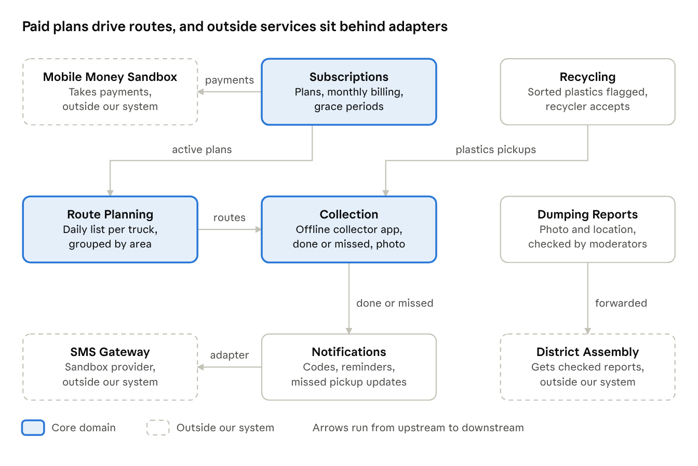

# Software Requirements Specification: Household Waste Pickup Scheduler

DCIT 415 Capstone, Project P14 · 22 November 2026 · Team BolaGo, Group 19

## 1. Introduction

### 1.1 Purpose

This document describes what the Household Waste Pickup Scheduler (we call it **BolaGo**) must do and how well it must do it. It is written for our lecturer, our team members and anyone who would test or use the system. It is the starting point for our design, code and tests in DCIT 415.

### 1.2 The problem

Many households in Ghana have no regular refuse collection. Their waste is burnt or dumped in drains, which blocks the drains, causes flooding and spreads disease. Households that do pay for collection often complain that the truck did not come and nobody told them why. BolaGo lets households subscribe and pay by mobile money, plans daily routes for each truck, lets collectors mark each pickup with photo proof even without internet, lets anyone report illegal dumping to the assembly, and lets households hand over sorted plastics to recyclers.

### 1.3 Scope

BolaGo will:

- Let households sign up, subscribe to a pickup plan and pay through a mobile money sandbox
- Bill subscribers every month and handle failed payments
- Build a daily route list for each truck, grouped by area
- Give collectors an app that works offline to mark pickups done or missed, with a photo
- Handle missed pickups with a free redo
- Let anyone report illegal dumping with a photo and location, checked by a moderator and forwarded to the assembly
- Let households flag sorted plastics so recyclers can collect them
- Show households their truck on a live map on pickup day, how many stops are left and when it will arrive, then show the collector's photo proof once the bin is emptied

BolaGo will **not**:

- Move real money (we only use a mobile money sandbox)
- Track trucks while the collector's phone has no network (households then see the last stop the truck finished)
- Enforce fines or punish anyone for dumping (that is the assembly's job)
- Use any real personal data (all test data is made up)

### 1.4 Definitions

| Term | Meaning |
|---|---|
| Household | A home that subscribes to waste pickup |
| Subscription | A paid plan, for example one pickup every week for GH₵ 60 a month |
| Pickup | One visit by a truck to collect a household's waste |
| Route list | The ordered list of pickups one truck must do on one day |
| Collector | A truck crew member who does pickups and marks them done or missed |
| Dispatcher | Staff at the waste company who plans trucks and routes |
| Missed pickup | A pickup that was due but not done |
| Dumping report | A report of waste dumped in a drain, road or open space |
| Assembly | The Municipal or District Assembly that is responsible for sanitation in the area |
| Recycler | A company or person that collects sorted plastics |
| MoMo | Mobile money, such as MTN MoMo or Telecel Cash |
| Act 843 | Ghana's Data Protection Act, 2012 |
| NFR | Non functional requirement: how well the system must work |
| MoSCoW | Must have, Should have, Could have, Will not have |
| WSJF | Weighted Shortest Job First, a way to rank work by value against effort |

### 1.5 References

- DCIT 415 Capstone Projects and Assignments Handbook, version 2
- ISO/IEC 25010:2023, Software product quality model
- Data Protection Act, 2012 (Act 843), Republic of Ghana
- IEEE 29148:2018, Requirements engineering

## 2. Overall Description

### 2.1 Product view

BolaGo is a new, standalone system with three parts:

- A mobile friendly web app (PWA) for households and recyclers
- An offline first collector app for truck crews
- A web dashboard for dispatchers, moderators and assembly officers

It talks to three outside services through its own adapters: a mobile money sandbox, an SMS gateway sandbox and email to the assembly.

### 2.2 Stakeholders and users

| Stakeholder | Who they are | What they need from BolaGo |
|---|---|---|
| Household | Families and tenants who pay for refuse collection | Know their pickup day, pay easily, get missed pickups fixed |
| Collector | Truck crew members, often in areas with poor network | A clear route list and a fast way to mark pickups, even offline |
| Dispatcher | Waste company staff who plan trucks | Balanced daily routes and a view of missed pickups |
| Recycler | Companies or individuals who buy sorted plastics | A list of homes with sorted plastics ready to collect |
| Moderator | Staff who check dumping reports | Remove fake reports and forward real ones |
| Assembly officer | Sanitation staff at the Municipal or District Assembly | Clear, checked dumping reports with photo and location |
| Waste company owner | The business running the trucks | Steady payments and fewer complaints |
| Data Protection Commission | Ghana's data protection regulator | Personal data handled as Act 843 requires |

### 2.3 User roles and permissions

| Role | Can do | Cannot do |
|---|---|---|
| Household | Subscribe, pay, request extra pickups, track their truck on pickup day, report missed pickups and dumping, flag plastics | See other households' addresses or payments, or see the truck after their own stop is done |
| Collector | See today's route for their truck, mark pickups done or missed with a photo | See payments, or households not on their route |
| Dispatcher | Build and change route lists, assign trucks, see missed pickups | Change payments or delete proof photos |
| Recycler | See and accept plastics pickups in their areas | See household phone numbers before accepting |
| Moderator | Review dumping reports, forward or reject them | Edit a report's photo or location |
| Assembly officer | See forwarded reports for their assembly, update their status | See who made a report |
| Admin | Manage areas, trucks, plans, prices and staff accounts | See payment details beyond the transaction reference |

### 2.4 Operating environment

- Household and collector screens work on low cost Android phones and on slow 3G connections
- The collector app keeps working with no internet for a full shift (up to 10 hours)
- Dashboards work on current Chrome, Edge and Firefox
- Server runs in Docker containers; database is PostgreSQL with PostGIS for locations
- Planned stack: Python with FastAPI for the backend, React for the web screens

### 2.5 Constraints

- Must follow the Data Protection Act, 2012 (Act 843)
- Only sandbox services for mobile money and SMS; no real money moves
- No real personal data at any stage
- Must be built by a team of 5 to 7 students within 12 weeks
- Code must live in GitHub with CI/CD, as the DCIT 415 handbook requires

### 2.6 Assumptions

- Each truck does one route per day, with up to 60 pickups
- Most households have a phone that can receive SMS and use mobile money
- Collectors have an Android phone with a camera, but often no data on their route
- Each area belongs to exactly one assembly, which receives reports by email

## 3. Functional Requirements

BolaGo has 15 user stories in five parts: Households, Routing, Collection, Dumping Reports and Recycling. Each story has acceptance criteria in Gherkin, with at least one normal path and one failure path.

### 3.1 User stories at a glance

| ID | As a | I want to | So that | Priority |
|---|---|---|---|---|
| US01 | Household | Sign up with my name, email and house location, verify my phone with a code, then log in later with just my phone | I can use BolaGo without a password | Must |
| US02 | Household | Choose a pickup plan and pay with mobile money | My waste is collected on a set day | Must |
| US03 | Household | Be billed every month, with a reminder before and a grace period if payment fails | My service does not stop by surprise | Must |
| US04 | Household | Request an extra one off pickup and pay for it | I can clear waste after a party or funeral | Should |
| US05 | Household | Get an SMS the evening before my pickup and see when the truck is close | I put my bin out on time | Must |
| US06 | Household | Report a missed pickup | It is collected again within 48 hours at no cost | Must |
| US07 | Dispatcher | Generate a route list for each truck, grouped by area | Trucks are not sent across town for one bin | Must |
| US08 | Collector | Download today's route and use it with no internet | I can work in areas with poor network | Must |
| US09 | Collector | Mark a pickup done or missed, with a photo and a reason | There is proof of what happened at each house | Must |
| US10 | Collector | Have my offline work sync on its own when I get network | Nothing I did is lost or sent twice | Must |
| US11 | Any user | Report illegal dumping with a photo and location | The assembly knows where to clean up | Must |
| US12 | Moderator | Review dumping reports and forward real ones to the assembly | Fake or repeated reports do not waste the assembly's time | Must |
| US13 | Assembly officer | See forwarded reports and update their status | Reporters can see that action was taken | Should |
| US14 | Household and recycler | Flag sorted plastics, and let a recycler accept and collect them | Plastics are recycled instead of burnt | Should |
| US15 | Household | Track my truck on a live map on pickup day, then see the photo proof and rate the pickup | I put my bin out in time and know it was really collected | Should |

### 3.2 Households

**US01 Sign up and log in**

```gherkin
Feature: Sign up and log in
  Scenario: New household signs up
    Given I tap "Sign up"
    And I enter my name, email, area and a pin on the map for my house
    And I enter the phone number "0241234567" and the 6 digit code sent by SMS
    Then my household account is created

  Scenario: Returning household logs in
    Given I already have an account
    When I tap "Log in" and enter my phone number and the SMS code
    Then I go straight to my home page

  Scenario: Wrong code three times
    When I enter a wrong code 3 times
    Then I see "Too many tries. Please wait 15 minutes."
```

**US02 Subscribe and pay**

```gherkin
Feature: Subscribe
  Scenario: Household pays for a weekly plan
    Given I choose "Weekly pickup, GH₵ 60 a month"
    When I approve the mobile money prompt on my phone
    Then my subscription is active
    And I see my pickup day, for example "Every Tuesday"

  Scenario: Payment callback arrives twice
    Given the mobile money sandbox sends the same success callback 2 times
    Then my account is charged and credited only once
```

**US03 Monthly billing**

```gherkin
Feature: Recurring billing
  Scenario: Reminder before billing
    Given my subscription renews on 1 March
    When it is 28 February
    Then I get an SMS reminder with the amount

  Scenario: Payment fails
    Given my renewal payment fails
    Then I get 7 days of grace with pickups still running
    And if I have not paid after 7 days my pickups pause
```

**US04 Extra pickup**

```gherkin
Feature: Extra pickup
  Scenario: Household books an extra pickup
    Given I have an active subscription
    When I request an extra pickup for Saturday and pay GH₵ 25
    Then it is added to Saturday's route for my area

  Scenario: No truck serves my area that day
    Given no truck covers my area on Sunday
    When I choose Sunday
    Then I see "No truck serves your area that day. Please choose another day."
```

**US05 Pickup reminder and status**

```gherkin
Feature: Pickup reminder
  Scenario: Reminder the evening before
    Given my pickup day is Tuesday
    When it is Monday at 18:00
    Then I get an SMS saying "Please put your bin out by 7:00 tomorrow."

  Scenario: Truck is close
    Given my house is 3 stops away on today's route
    Then my home page shows "Truck is close, about 3 stops away"
```

**US15 Track my truck and see proof**

```gherkin
Feature: Live truck tracking
  Scenario: Household watches the truck coming
    Given today is my pickup day
    And the truck for my area has started its route
    When I tap "Track your truck live" on my home page
    Then I see the truck and my home on a map
    And I see how many stops are left before my house
    And I see the arrival time, for example "About 12 min away"
    And I see the collector's first name, the truck number and a call button

  Scenario: Collector's phone loses network
    Given the truck's last location is more than 5 minutes old
    Then the map shows "Last seen at Stop 12, 7:31"
    And the arrival time is hidden until the location updates

  Scenario: Bin is emptied
    Given the collector marks my stop done with a photo
    Then my tracking screen changes to "Pickup done"
    And I see the photo, the time and the steps of the pickup
    And I can rate the pickup from 1 to 5 stars

  Scenario: Tracking is only for my own pickup
    Given the truck has finished my stop
    Then I can no longer see where the truck is
```

**US06 Missed pickup**

```gherkin
Feature: Missed pickup
  Scenario: Household reports a missed pickup
    Given my pickup was due today and was not marked done
    When I tap "Report missed pickup"
    Then a free redo is added to a route within 48 hours
    And I get an SMS with the new day

  Scenario: Collector already marked it missed with a reason
    Given the collector marked my pickup missed because "Gate locked"
    Then I see the reason and the photo
    And I can still ask for a free redo
```

### 3.3 Routing

**US07 Daily route lists**

```gherkin
Feature: Route lists
  Scenario: Dispatcher builds Tuesday's routes
    Given 140 households in 3 areas are due on Tuesday and there are 3 trucks
    When the dispatcher taps "Build routes"
    Then each truck gets the pickups for its own area, in stop order
    And no truck has more than 60 pickups

  Scenario: Not enough trucks
    Given 200 pickups are due and only 2 trucks are available
    When the dispatcher builds routes
    Then 80 pickups are flagged "No truck available"
    And the dispatcher is asked to add a truck or move them to another day
```

### 3.4 Collection

**US08 Offline route list**

```gherkin
Feature: Offline route
  Scenario: Collector starts the day
    Given the collector opens the app at the depot with network
    Then today's route is saved on the phone
    And it still opens after the phone loses network

  Scenario: Route changed after download
    Given the dispatcher adds an extra pickup after the route was saved
    When the collector's phone next gets network
    Then the new pickup appears on the route with a "New" label
```

**US09 Mark done or missed with photo**

```gherkin
Feature: Mark pickup
  Scenario: Pickup done
    Given I am at stop 12
    When I take a photo and tap "Done"
    Then the stop is marked done with the photo and the time

  Scenario: Pickup missed
    When I tap "Missed" without choosing a reason
    Then I see "Please choose a reason, such as Gate locked or No bin out."
```

**US10 Sync when back online**

```gherkin
Feature: Offline sync
  Scenario: Work syncs when network returns
    Given I marked 15 stops while offline
    When my phone gets network
    Then all 15 updates and photos are uploaded within 2 minutes

  Scenario: Same update sent twice
    Given the network dropped halfway through a sync
    When the app sends the same stop update again
    Then the server keeps only one record for that stop
```

### 3.5 Dumping Reports

**US11 Report illegal dumping**

```gherkin
Feature: Dumping report
  Scenario: Report with photo and location
    Given I see rubbish dumped in a drain
    When I take a photo and confirm the location on the map
    Then my report is sent for review
    And I get a report number

  Scenario: Report without a photo
    When I try to send a report with no photo
    Then I see "Please add a photo so the assembly can see the problem."
```

**US12 Moderate and forward**

```gherkin
Feature: Moderation
  Scenario: Moderator forwards a real report
    Given a report has a clear photo of dumping
    When the moderator taps "Forward to assembly"
    Then the assembly for that area receives it by email and on its dashboard
    And the action is saved in the audit log

  Scenario: Same spot reported many times
    Given there is already an open report within 50 metres of this one
    Then the new report is joined to the open one instead of sent again
```

**US13 Assembly updates status**

```gherkin
Feature: Assembly follow up
  Scenario: Assembly marks a site cleared
    Given a forwarded report is open
    When the assembly officer marks it "Cleared" and adds a photo
    Then the reporter gets an SMS that the site was cleared

  Scenario: Officer tries to see who reported
    When the assembly officer opens a report
    Then the reporter's name and phone number are not shown
```

### 3.6 Recycling

**US14 Recycling pickups**

```gherkin
Feature: Recycling
  Scenario: Recycler collects flagged plastics
    Given a household flags 2 bags of sorted plastics
    When a recycler serving that area accepts the pickup
    Then the household gets an SMS with the recycler's name and pickup day

  Scenario: Two recyclers accept at the same time
    Given two recyclers tap "Accept" on the same pickup at once
    Then only the first one gets it
    And the second sees "Another recycler has taken this pickup."
```

## 4. Non Functional Requirements

BolaGo has 9 measurable NFRs covering six ISO/IEC 25010:2023 quality characteristics. The handbook asks for at least 6.

| ID | ISO 25010 characteristic | Requirement | Target and conditions | How we will check it |
|---|---|---|---|---|
| NFR01 | Performance efficiency | Route lists are built quickly | Routes for 2,000 households and 10 trucks are built in under 10 seconds on staging | Timed test with made up data in CI |
| NFR02 | Performance efficiency | Household pages respond quickly | 95% of requests answered in under 2 seconds with 200 users at once | Load test with Locust, report the 95th percentile |
| NFR03 | Reliability (availability) | System is up during collection hours | 99.5% uptime from 5:00 to 20:00 every day, measured over 30 days | Uptime monitor on the /health endpoint |
| NFR04 | Reliability (fault tolerance) | No collector work is lost offline | 100% of stops marked offline for up to 10 hours are synced within 2 minutes of network returning, with 0 duplicates | Integration test that cuts the network mid sync |
| NFR05 | Functional suitability (correctness) | Payments are never counted twice | 0 double charges when the mobile money sandbox repeats a callback up to 5 times | Automated test that replays callbacks |
| NFR06 | Security (confidentiality) | Users only see what their role allows | 0 successful attempts to see another household's address or payment by changing an ID in the link | Automated IDOR tests in CI and an OWASP ZAP scan |
| NFR07 | Interaction capability (usability) | Collectors mark stops fast | A collector marks a stop done with a photo in 3 taps and under 10 seconds | Timed test with 5 classmates using the collector app |
| NFR08 | Maintainability | Code is easy to test and change | At least 70% branch coverage on domain code; no high or critical issues in SonarCloud | Coverage gate and SonarCloud check in GitHub Actions |
| NFR09 | Performance efficiency | Truck tracking is up to date | While the collector's phone has network, the truck on the household map is never more than 30 seconds old, and the arrival time is right to within 5 minutes for 90% of stops | Test drive of 2 routes with made up households, comparing shown and real arrival times |

## 5. External Interfaces

### 5.1 User interfaces

| Screen | Used by | Main parts |
|---|---|---|
| Welcome, sign up and log in | Household, recycler | Sign up (name, email, area, map pin, phone, SMS code) or Log in (phone, SMS code) |
| Choose a plan and pay | Household | Plan cards, price per month, Pay with MoMo button, payment status |
| Household home | Household | Next pickup day, Track your truck live button, subscription status, Report missed pickup, Extra pickup |
| Track the truck | Household | Live map with the truck and the house, stops left, arrival time, collector's first name and truck number, call button, reminder to put the bin out, Report a problem |
| Pickup done | Household | Collector's photo proof with time, steps of the pickup, next pickup day, star rating, Report it if the bin was not emptied |
| Report dumping | Any user | Camera, map pin, short note, Send report |
| Recycling | Household, recycler | Flag sorted plastics (household); list of pickups to accept (recycler) |
| Today's route | Collector | Offline banner, stop list in order, progress, sync status |
| Stop details | Collector | Address and landmark, Take photo, Done, Missed with reason |
| Dispatcher dashboard | Dispatcher | Build routes, trucks and their stop counts, missed pickups to reschedule |
| Moderation and assembly | Moderator, assembly officer | Reports queue with photo and map, Forward, Reject, Join duplicate, status updates |

All household and collector screens use large buttons, plain English and work at a screen width of 360 pixels.

### 5.2 Software interfaces

| Interface | Purpose | Notes |
|---|---|---|
| Mobile money sandbox | Take subscription and extra pickup payments | For example the MTN MoMo sandbox or Hubtel test mode. Behind our own adapter; every callback is checked and processed only once |
| SMS gateway sandbox | Send codes, reminders, missed pickup and report updates | For example the Africa's Talking sandbox. Behind an adapter |
| Assembly email | Send forwarded dumping reports | A plain email with the photo, location link and report number |
| Map tiles | Show house pins and dumping locations | OpenStreetMap tiles |
| PostgreSQL with PostGIS | Store households, routes, pickups, payments, reports and audit logs | Locations stored as points; phone numbers encrypted at rest |
| BolaGo REST API | Connect the apps to the backend | JSON over HTTPS; documented with OpenAPI |

### 5.3 Communication

- All traffic uses HTTPS (TLS 1.2 or higher)
- The collector app stores updates on the phone and sends them in a queue when network returns; each update carries a unique ID so the server can ignore repeats
- Mobile money and SMS callbacks are verified before they change anything

## 6. Data Protection and Act 843

The most sensitive data in BolaGo is where each household lives, the photos taken at their gate, and who reported dumping. A report can cause conflict with neighbours, so reporters must stay anonymous to the assembly.

### 6.1 Data we keep

| Data | Why we need it | Who can see it | How long we keep it |
|---|---|---|---|
| Name, phone number, email | Sign in, SMS and receipts | The household; admins | Until the account is closed, or 2 years with no activity |
| House location and landmark | So the truck can find the house | The household; the collector on that route, only on pickup day | Until the account is closed |
| Payment records | Prove what was paid | The household; admins | 6 years for accounting, then deleted. We keep only the transaction reference, never a PIN |
| Pickup proof photos | Prove a pickup was done or missed | The household, dispatcher, collector who took it | 90 days, then deleted |
| Truck location on pickup day | Show households where their truck is and when it will arrive | Households on that route, only until their own stop is done; dispatcher | 7 days for complaints, then only the stop times are kept |
| Dumping report photo and location | Show the assembly the problem | Moderators; the assembly once forwarded | 1 year after the report is closed |
| Reporter identity | Send updates to the reporter | Moderators only, never the assembly | 1 year after the report is closed |
| Audit log | Prove who did what | Admins | 5 years; cannot be edited |

We do **not** collect ID card numbers, mobile money PINs or bank details.

### 6.2 How BolaGo meets the Act 843 principles

| Act 843 principle | What BolaGo does |
|---|---|
| Accountability | A named Security and Privacy Lead on the team; audit log on payments, moderation and route changes |
| Lawful processing and consent | Clear tick box at sign up for terms, SMS and use of the house location |
| Specific purpose | House location used only for pickups, never shared with recyclers before they accept. Truck location is only shown to households still waiting on that day's route, and only during collection hours |
| Compatible further use | Area reports use counts only, never names or addresses |
| Quality of information | Households can move their map pin and update their details |
| Openness | Short privacy notice at sign up and in the first SMS |
| Security safeguards | HTTPS, encrypted phone numbers, role based access, faces and car plates blurred in report photos, location data removed from proof photos, secrets kept out of code |
| Data subject participation | Users can download their data and ask for their account to be deleted |

### 6.3 Ground rules for the team

- Only made up test data in every environment, including demos
- No real money and no real SMS outside the sandboxes
- Never show a reporter's identity outside the moderator role
- API keys and passwords stored in GitHub Secrets, never in the code

## 7. Prioritised Backlog

Sign up and daily route lists rank highest, because nearly everything else depends on them. Recycling pickups rank last, because households and trucks can run without them at first.

### 7.1 MoSCoW

- **Must have:** US01, US02, US03, US05, US06, US07, US08, US09, US10, US11, US12
- **Should have:** US04, US13, US14, US15
- **Could have:** Route ordering optimisation compared with a baseline (the optional AI bonus feature)
- **Will not have (this semester):** Real payments, fines for dumping

### 7.2 WSJF ranking

We scored each feature from 1 to 13 (1, 2, 3, 5, 8, 13). The formula is:

```math
WSJF = \frac{\text{Business value} + \text{Time criticality} + \text{Risk reduction}}{\text{Job size}}
```

| Rank | Feature | Stories | Business value | Time criticality | Risk reduction | Cost of delay | Job size | WSJF |
|---|---|---|---|---|---|---|---|---|
| 1 | Sign up and log in | US01 | 8 | 8 | 5 | 21 | 3 | 7.00 |
| 2 | Daily route lists per truck | US07 | 13 | 13 | 5 | 31 | 5 | 6.20 |
| 3 | Illegal dumping reports | US11 | 8 | 5 | 5 | 18 | 3 | 6.00 |
| 4 | Missed pickup handling | US06 | 13 | 8 | 8 | 29 | 5 | 5.80 |
| 5 | Pickup reminders and truck status | US05 | 8 | 5 | 3 | 16 | 3 | 5.33 |
| 6 | Offline collector app with photo proof | US08, US09, US10 | 13 | 13 | 13 | 39 | 8 | 4.88 |
| 7 | Subscriptions and recurring billing | US02, US03 | 13 | 13 | 8 | 34 | 8 | 4.25 |
| 8 | Moderation and assembly follow up | US12, US13 | 5 | 3 | 13 | 21 | 5 | 4.20 |
| 9 | Live truck tracking and pickup proof | US15 | 8 | 5 | 5 | 18 | 5 | 3.60 |
| 10 | Extra one off pickups | US04 | 5 | 3 | 2 | 10 | 3 | 3.33 |
| 11 | Recycling pickups | US14 | 5 | 2 | 3 | 10 | 5 | 2.00 |

Worked example for rank 1: (8 + 8 + 5) ÷ 3 = 21 ÷ 3 = 7.00. For rank 6: 39 ÷ 8 = 4.875, rounded to 4.88.

WSJF sets the order of value, but some features depend on others. Route lists need active subscriptions to know who is due, so in practice we build sign up, then subscriptions, then routes and the collector app together.

## 8. Context Map

BolaGo splits into six bounded contexts. Subscriptions, Route Planning and Collection are the core domain, where most of our effort and tests will go.



Identity and Access serves every context, and every context writes to a shared audit log, so we do not draw a line to each box.

| Relationship | Pattern | What it means for us |
|---|---|---|
| Subscriptions to Route Planning | Customer and supplier | Route Planning only plans pickups for households with an active or grace period plan |
| Recycling to Collection | Published events | An accepted plastics pickup is added to the recycler's pickup list |
| Route Planning to Collection | Published language | The route list is a fixed format the collector app downloads and keeps offline |
| Collection to Notifications | Published events | Done and missed events trigger SMS to households, and truck location updates feed the household's live tracking screen |
| Subscriptions to Mobile Money Sandbox | Anticorruption layer | Our adapter hides the provider and makes repeated callbacks safe |
| Notifications to SMS Gateway | Anticorruption layer | Our adapter lets us switch SMS providers without touching the rest of the code |
| Dumping Reports to District Assembly | Anticorruption layer | Only checked reports are sent, with the reporter's identity removed |
